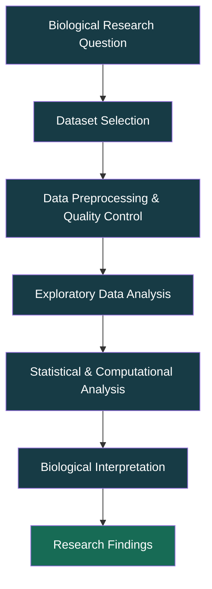

<div align="center">

# 🧬 PAN-CANCER
### Computational Genomics & Multi-Omics Research

**Decoding Molecular Patterns Across Cancer Types**

<p>
  
  
  
  
</p>

```text
 ██████╗  █████╗ ███╗   ██╗   ██████╗ █████╗ ███╗   ██╗ ██████╗███████╗███████═╗
 ██╔══██╗██╔══██╗████╗  ██║  ██╔════╝██╔══██╗████╗  ██║██╔════╝██╔════╝██╔ ═ ═██╗
 ██████╔╝███████║██╔██╗ ██║  ██║     ███████║██╔██╗ ██║██║     █████╗  ██████╔══╝
 ██╔═══╝ ██╔══██║██║╚██╗██║  ██║     ██╔══██║██║╚██╗██║██║     ██╔══╝  ██╔══██╗
 ██║     ██║  ██║██║ ╚████║  ╚██████╗██║  ██║██║ ╚████║╚██████╗███████╗██║  ██║
 ╚═╝     ╚═╝  ╚═╝╚═╝  ╚═══╝   ╚═════╝╚═╝  ╚═╝╚═╝  ╚═══╝ ╚═════╝╚══════╝╚═╝  ╚═╝

          ───── COMPUTATIONAL ONCOLOGY & DATA SCIENCE ─────
```

*Exploring the molecular architecture of cancer through computational biology.*

</div>

---

## 🧫 01. Project Overview

Cancer represents a diverse group of diseases characterized by complex genetic, molecular, and cellular alterations.

**Pan-Cancer Analysis** is a computational research approach that investigates molecular similarities and differences across multiple cancer types.

By integrating genomic, transcriptomic, and clinical information, researchers can explore shared molecular mechanisms, cancer-specific alterations, potential biomarkers, and biological pathways associated with cancer development and progression.

This repository is an academic learning and research workspace dedicated to exploring the foundations, datasets, computational methodologies, and research opportunities in **Pan-Cancer Bioinformatics**.

## 🎯 02. Research Objectives

- Understand the biological and computational foundations of Pan-Cancer research.
- Investigate shared and cancer-specific genomic alterations.
- Explore gene expression patterns across different cancer types.
- Identify potential molecular biomarkers and biological signatures.
- Understand multi-omics data integration and its applications.
- Explore statistical and computational approaches to cancer data.
- Develop reproducible bioinformatics research workflows.

## 🔬 03. Core Research Domains

| Research Area | Scientific Focus |
|:---|:---|
| 🧬 Cancer Genomics | Genomic alterations and mutation profiling |
| 🧪 Transcriptomics | Gene expression and RNA sequencing |
| 🔍 Biomarker Discovery | Potential diagnostic and prognostic biomarkers |
| 🧫 Differential Expression | Upregulated and downregulated genes |
| 🕸️ Pathway Analysis | Molecular pathways and biological networks |
| 📈 Survival Analysis | Molecular features and patient survival |
| 🧩 Multi-Omics Integration | Integration of different biological data layers |
| 🧠 Computational Biology | Computational investigation of cancer mechanisms |

## 🧬 04. Computational Research Workflow

The analytical workflow will depend on the selected research question and dataset.



## 🧪 05. Bioinformatics Ecosystem

### Programming & Data Analysis

| Technology | Application |
|:---|:---|
| Python | Scientific computing and data analysis |
| R | Statistical computing and bioinformatics |
| NumPy | Numerical computation |
| Pandas | Biological data manipulation |
| Matplotlib | Scientific visualization |
| Seaborn | Statistical data visualization |
| Biopython | Biological sequence analysis |

### Bioinformatics Databases & Platforms

| Resource | Research Application |
|:---|:---|
| [TCGA](https://www.cancer.gov/ccg/research/genome-sequencing/tcga) | Cancer genomic and molecular data |
| [GDC Data Portal](https://portal.gdc.cancer.gov/) | Cancer genomic data access |
| [cBioPortal](https://www.cbioportal.org/) | Cancer genomics exploration |
| [UCSC Xena](https://xenabrowser.net/) | Genomic and multi-omics visualization |
| [NCBI GEO](https://www.ncbi.nlm.nih.gov/geo/) | Functional genomics datasets |
| [Bioconductor](https://bioconductor.org/) | R-based bioinformatics analysis |

### Statistical & Computational Methods

- Differential Gene Expression Analysis
- Genomic Mutation Profiling
- Gene Set Enrichment Analysis
- Biological Pathway Analysis
- Kaplan-Meier Survival Analysis
- Principal Component Analysis (PCA)
- Multi-Omics Data Integration

*These are potential methods and learning areas, not a finalized analytical pipeline.*

## 📂 06. Repository Architecture

```text
Pan-Cancer/
│
├── README.md
│
├── 01_Fundamentals/
│   ├── pan_cancer_overview.md
│   └── key_biological_concepts.md
│
├── 02_Literature_Review/
│   ├── research_papers.md
│   └── research_gaps.md
│
├── 03_Datasets/
│   └── dataset_documentation.md
│
├── 04_Analysis/
│   ├── preprocessing/
│   ├── exploratory_analysis/
│   ├── gene_expression/
│   ├── mutation_analysis/
│   └── survival_analysis/
│
├── 05_Visualizations/
│
├── 06_Research_Notes/
│
└── 07_References/
    └── references.md
```

## 📚 07. Initial Learning Foundation

The initial study phase focuses on:

- Introduction to Pan-Cancer Research
- Cancer Genomics and Transcriptomics
- The Cancer Genome Atlas (TCGA)
- Gene Expression and Differential Expression
- Genomic Mutations and Molecular Biomarkers
- Multi-Omics Data Analysis
- Biological Pathway Analysis
- Cancer Survival Analysis

## 🌍 08. Scientific Significance

Pan-Cancer research provides a broader understanding of cancer biology by examining molecular characteristics across multiple cancer types.

Potential research contributions include:

- Understanding shared and distinct cancer mechanisms.
- Exploring molecular heterogeneity across cancer types.
- Identifying potential diagnostic and prognostic biomarkers.
- Investigating molecular pathways and therapeutic targets.
- Supporting the development of precision oncology research.

## 📊 09. Research Progress

**Current Phase: Foundation & Research Preparation**

- [x] Initial Pan-Cancer concept exploration.
- [x] Understanding fundamental biological terminology.
- [x] Exploring research importance and applications.
- [ ] Systematic literature review.
- [ ] Research gap identification.
- [ ] Dataset selection and exploration.
- [ ] Data preprocessing and quality assessment.
- [ ] Statistical and computational analysis.
- [ ] Biological interpretation and validation.
- [ ] Research manuscript development.

## 👨‍🔬 10. Researcher

**Tamanna Rahman Tanni**

Lecturer | Computer Science & Engineering | Hamdard University Bangladesh

**Ahmed Fardin**

Undergraduate Student | Computer Science & Engineering | Hamdard University Bangladesh

**Research Interests**

Bioinformatics · Computational Biology · Cancer Genomics · Biomedical Data Science

---

<div align="center">

### 🧬 FROM BIOLOGICAL DATA TO SCIENTIFIC DISCOVERY

*Learning the Biology. Understanding the Data. Exploring the Science.*

**PAN-CANCER | COMPUTATIONAL BIOLOGY RESEARCH WORKSPACE**

</div>
